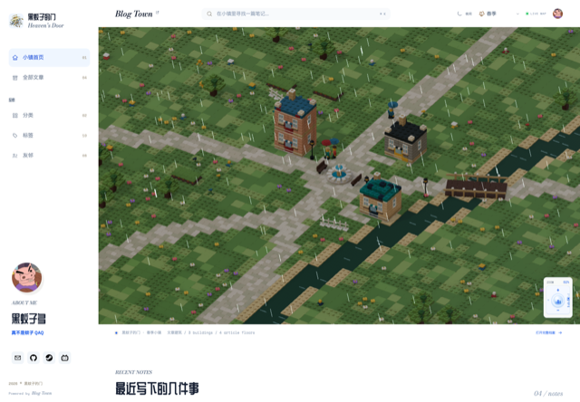
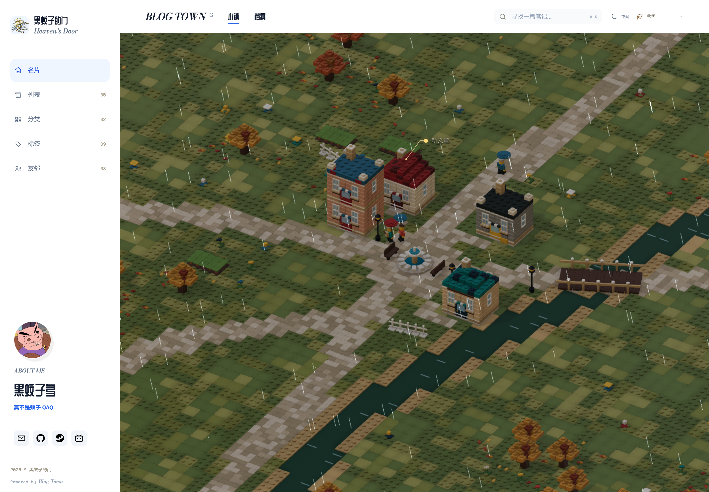
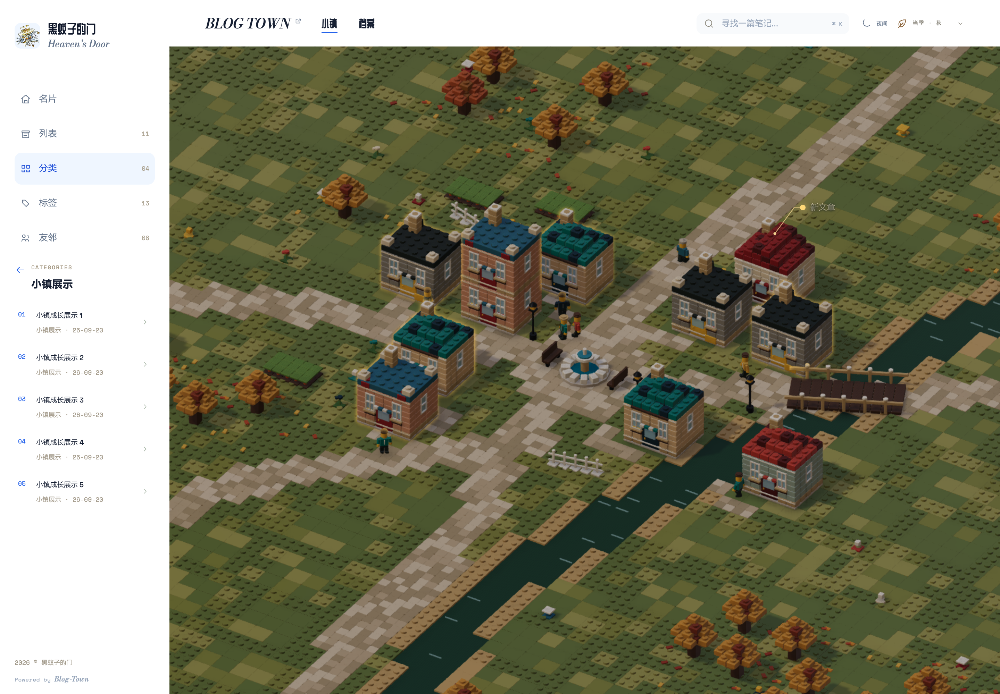
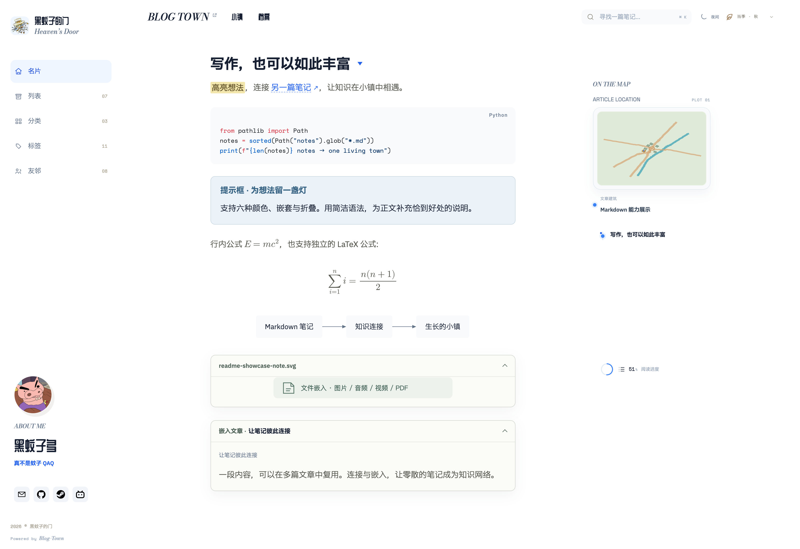

# Town Blog Framework

> 把博客变成一座会持续生长、会随季节变化的积木小镇。

Town Blog Framework 是一个基于 **Astro + React + Babylon.js** 的静态博客框架。每篇文章都会在小镇中拥有一栋建筑；同一系列的文章会组成同一栋建筑的不同楼层。读者可以探索地图，也可以通过档案、分类、标签、搜索和文章目录直接阅读。

<p align="center">
  
</p>

<p align="center">
  <em>文章不只是列表中的条目，而是小镇里可以被发现、被记住的一栋栋建筑。</em>
</p>

展示截图均取自本地运行的博客，新增文章使用临时演示内容；正文示例用于展示渲染能力，不展示个人文章详情。

## 为什么是小镇？

博客会随着文章增多而变成长长的列表。Town Blog Framework 把这种增长转化为空间关系：

- **写一篇文章，就为小镇添一栋建筑。**
- **同一系列文章，组成同一栋建筑的不同楼层。**
- **建筑、文章列表、搜索和目录共同提供内容入口。**
- **文章越多，小镇越丰富，而不是越难以浏览。**

## 四季小镇

小镇拥有春、夏、秋、冬四种可切换形态。四季共享同一份建筑布局、道路、河流和文章坐标，所以切换季节时，文章入口不会被重新打乱：变化发生在材质、植被、地面、雪盖和天气层。

<table>
  <tr>
    <td></td>
    <td></td>
    <td></td>
    <td></td>
  </tr>
  <tr>
    <td align="center"><strong>春</strong><br />新绿与花朵</td>
    <td align="center"><strong>夏</strong><br />浓绿与水面</td>
    <td align="center"><strong>秋</strong><br />金黄与落叶</td>
    <td align="center"><strong>冬</strong><br />雪地与冰面</td>
  </tr>
</table>

季节可以按设备本地月份自动选择，也可以手动切换。雨雪天气使用站点种子和时间段确定，画面离开视口时会暂停渲染；手机和减少动态效果偏好会自动降低动态开销。

## 会生长，也能快速找到文章

新增文章会为小镇添上建筑，已有建筑的位置和样式保持稳定；同系列文章继续共享一栋建筑的不同楼层。在侧边栏选择分类后，对应的文章建筑会高亮，帮助读者把内容分类与小镇中的位置联系起来。

<p align="center">
  
</p>

发布于最近 **14 天**且读者尚未点进过的文章，会在对应建筑旁显示新文章提示，帮助读者发现更新，也让建筑作为文章入口的用途更直观。

## 文章阅读体验

### 富 Markdown 渲染器

<p align="center">
  
</p>

文章渲染器在构建阶段完成处理，不要求读者在浏览器中加载代码高亮、公式或图表引擎。除了基础 Markdown，还支持：

- 单换行保留为真实换行、表格、任务列表、删除线和 `==高亮==`。
- Shiki 多语言代码高亮，代码块右上角显示语言名称。
- 外部链接末尾的链接标识，帮助读者识别可跳转内容。
- MathJax 的行内公式 `$...$` 和独立公式 `$$...$$`。
- Obsidian 风格提示框，支持颜色、标题、展开/收起和多层嵌套。
- `[[文章]]`、`[[文章|自定义文字]]` 双向链接入口，直接跳转到其他文章。
- `![[文件]]` 图片、音频、视频、PDF、附件和整篇文章嵌入；文章嵌入支持收起与展开。
- `mermaid` 或 `pele` 代码围栏，通过 Pele 生成静态图表。

文章页的小地图标记当前建筑，目录随阅读位置聚焦，并显示阅读进度；移动端通过悬浮阅读球展开目录。系列文章提供正文上方的系列抽屉，以及文末同系列的上一篇和下一篇。

完整语法和安全边界请查看 [使用文档：docs/USAGE.md](docs/USAGE.md)。

## 核心能力

- **交互式 3D 小镇首页**：通过建筑、道路、提示和轻量角色活动探索文章。
- **四季与天气**：共享布局的春夏秋冬、雨雪效果、昼夜模式和减少动态效果支持。
- **富 Markdown**：基础排版、代码高亮、公式、提示框、双向链接、文件/文章嵌入和 Pele 图表。
- **文章阅读工具**：系列抽屉、同系列上一篇/下一篇、独立目录滚动、阅读进度和文章小地图。
- **多种内容入口**：小镇、档案、列表、分类、标签、友邻和搜索并存。
- **响应式布局**：桌面端强调探索，移动端保留轻量、直接的阅读路径。
- **纯静态部署**：不依赖数据库，适合 GitHub Pages、Cloudflare Pages、Netlify 等静态托管平台。

## 如何工作

文章由 `src/content/posts/` 中的 Markdown 文件驱动。构建时，框架会完成以下工作：

1. 校验 frontmatter 和发布时间。
2. 渲染文章正文、代码、公式、图表和嵌入内容。
3. 根据文章与系列关系生成稳定的小镇布局。
4. 输出文章页面、档案页面和小镇首页的静态文件。
5. 在浏览器中只加载交互所需的 React 与 Babylon.js 运行时。

如果不想逐栋探索，可以直接使用档案页、侧边栏列表、分类、标签或顶部搜索。

## 快速开始

### 1. 克隆并安装

```bash
git clone https://github.com/BURIBURI-ZAEMON1/Blog-Town
cd <项目目录>
npm install
```

### 2. 启动开发服务器

```bash
npm run dev
```

根据终端输出访问本地地址，即可预览小镇。

### 3. 开始定制

1. 编辑 `src/config/site.ts`，填写网站名称、作者资料和正式域名。
2. 替换 `public/assets/profile/` 中的 Logo 与头像占位图。
3. 复制 `src/content/posts/_article-template.md.example`，创建第一篇文章。
4. 将文章图片与附件放入 `public/assets/posts/<文章 ID>/`。
5. 在 `src/config/site.ts` 中启用需要展示的社交网站链接或友链。
6. 运行完整检查并构建静态站点：

```bash
npm run verify
npm run build
```

完整的字段、资源目录、文章 frontmatter、Markdown 语法、社交链接和部署说明，请阅读：

➡️ [使用文档：docs/USAGE.md](docs/USAGE.md)

## 项目结构

```text
src/config/site.ts                         站点、作者、相关链接与友链配置
src/content/posts/                         Markdown 文章
src/content/posts/_article-template.md.example 文章 frontmatter 与正文模板
src/lib/markdown.ts                        Markdown 解析、分段和安全处理
src/lib/markdown-rich.ts                   代码、公式与 Pele 图表渲染
src/lib/markdown-embeds.ts                 文件与文章嵌入解析
public/assets/links/                       预置及自定义相关网站 Logo
public/assets/friends/                     友链头像或 Logo
public/assets/posts/                       文章图片与附件
public/assets/profile/                     网站 Logo 与作者头像
assets/readme/                             README 展示截图与四季样例
docs/USAGE.md                              面向使用者的完整文档
```

## 常用命令

```bash
npm run dev              # 启动开发服务器
npm run check            # Astro 与 TypeScript 检查
npm run build            # 构建静态站点
npm run verify           # 完整检查、构建和小镇回归测试
npm run verify:markdown  # 检查富 Markdown、嵌入与 HTML 安全过滤
npm run preview          # 预览 dist/ 构建结果
```
