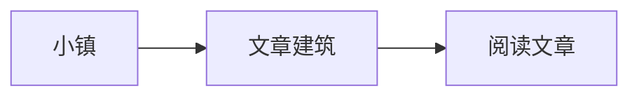

引言第一行
单换行后的第二行。

# 语法与排版

**加粗**、*斜体*、~~删除线~~、==重点高亮==、`==代码不高亮==`。

[外部文档](https://example.com/docs) · [本页章节](#article-数学与图表-1) · [引用链接][guide]

- [ ] 还没读的文章
- [x] 已经读完的文章
  - [x] 嵌套任务

| 名称 | 说明 |
| --- | --- |
| 换行 | 正常保留 |
| 高亮 | ==表格中的重点== |

> 普通引用，保留原有样式。

> [!blue] 蓝色提示
> 第一行
> 第二行，支持 **加粗** 与 $a^2$。
>
> > [!purple]- 内层默认收起
> > 嵌套提示的内容。

> [!red]+ 默认展开的提示
> 红色内容。

> [!yellow] 黄色提示
> ==需要留意的内容==

> [!green]
> 无标题的绿色内容。

> [!gary] 灰色提示
> gary 与 gray、grey 同义。

> [!]- 无颜色时默认蓝色
> 默认收起的内容。

```TypeScript
interface Reader { name: string; visited: boolean }
const reader: Reader = { name: '小镇访客', visited: true };
console.log(reader.name);
```

```python
def welcome(name: str):
    return f"你好，{name}"
```

```unknown-language
未知语言保留纯文本；<script>alert('escaped')</script>
```

## 数学与图表

行内公式 $E = mc^2$，分数 $\frac{1}{2}$，集合 $\mathbb{R}$。

$$
\begin{bmatrix} a & b \\ c & d \end{bmatrix}
\quad \sum_{i=1}^{n} i = \frac{n(n+1)}{2}
$$



```pele
sequenceDiagram
  访客->>小镇: 选择一栋建筑
  小镇-->>访客: 打开文章
```

### 带有 ==高亮== 与 $x^2$ 的标题

[guide]: https://example.com/guide "位于另一个章节的链接定义"

## 文件嵌入

![[assets/posts/obsidian-sync/cover.png]]

![[assets/posts/obsidian-sync/missing.txt]]

[[obsidian-sync]]、[[folder/a|另一篇文章]]、[[unknown-note|未找到的文章]]。
